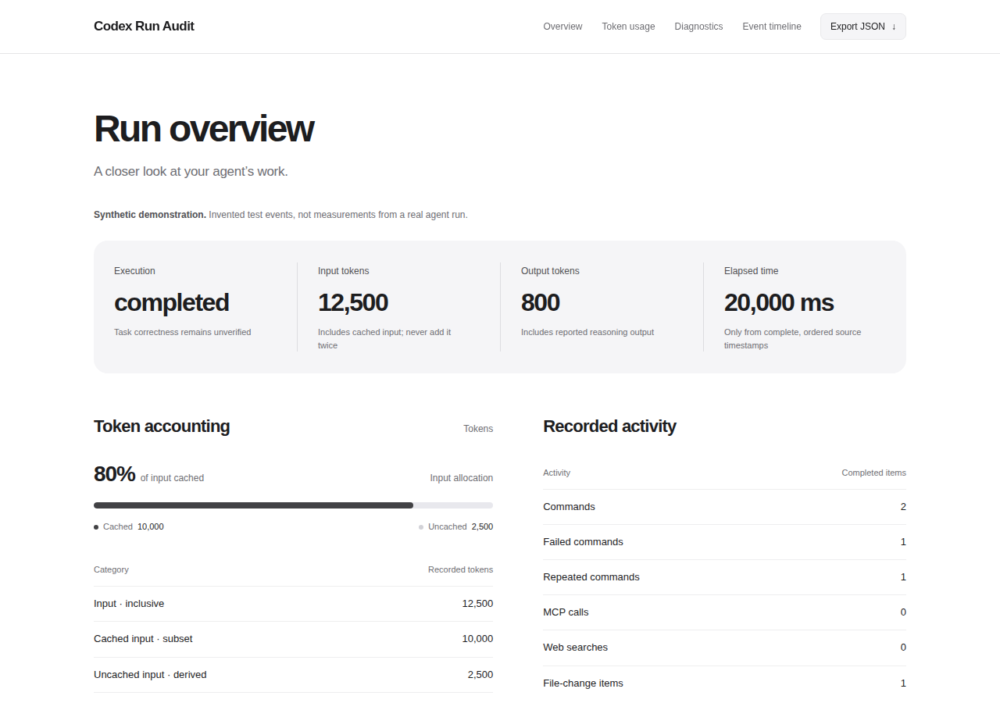

# Codex Run Audit

**Turn a Codex execution export into a report you can actually read.**

An offline Codex run analyzer for token usage, command failures, repeated activity,
and execution history. Get a local HTML report, inspect the evidence, and decide
what to investigate next—without uploading your transcript or calling another model.

**1.0.0 release candidate · Node.js 24+ · TypeScript · MIT · Zero runtime dependencies**

[Quick start](#quick-start) · [What it shows](#what-it-shows) · [Commands](#commands) · [Compatibility](docs/compatibility.md) · [Contributing](CONTRIBUTING.md)



*An actual generated report, captured by the browser checks. The demo data is synthetic.*

## When a run finishes, questions remain

Did a command fail even though the agent finished? How much input was cached?
Was the same command run twice? Is a missing number actually zero?

Codex Run Audit makes those questions easier to inspect in one export. It keeps
**execution completion separate from task success**, and **missing measurements
separate from zero**. Every diagnostic includes an evidence-specific next step.

Use it for a single-run review, a debugging handoff, or a descriptive before/after
comparison. It does not scan your account, estimate subscription allowance, or
claim that fewer tokens mean better work.

## Quick start

Requires **Node.js 24 or later** and access to this currently private repository.
The package is not published to npm.

```sh
git clone https://github.com/nathandavismail-cmyk/codex-run-audit.git
cd codex-run-audit
npm ci
node dist/src/cli.js demo --out reports/first-look --open
```

`npm ci` builds the CLI. The demo writes `index.html` and `report.json` into a new
directory. It needs no Codex installation, API key, or model call.

`--open` requests Safari on macOS or your desktop HTML handler on Linux. If a
browser cannot launch, the report stays saved and the CLI prints a `file:` URL.
Paste it into a browser to see the report. Opening an HTML file in an editor may
show its source instead. Choose a new output directory when running again.

For packaged installation, direct Git installation, updates and removal, see the
[installation guide](docs/install.md).

## What it shows

| Question | Evidence in the report |
| --- | --- |
| How many tokens were recorded? | Input and output totals; cached input and reasoning subsets when supplied; derived uncached input |
| What needs investigation? | Failed commands, repeated command text, unfinished activity and stream errors, with next steps |
| What happened in order? | A bounded timeline and per-turn measurements, without raw commands or messages |
| How complete is the export? | Missing usage, unknown event types and excluded duplicate terminal events |
| What changed between runs? | Candidate-minus-baseline differences, with unknowns preserved |
| Where did these numbers come from? | Source SHA-256, byte count, format and generator version |

**Example:** the synthetic demo records 12,500 input tokens, including 10,000
cached tokens. That leaves 2,500 uncached tokens—not 22,500 total input. It also
records a command failure within a completed turn. Neither fact establishes
whether the developer's task succeeded.

## Commands

From a source checkout:

```sh
# Analyze one existing Codex execution export.
node dist/src/cli.js analyze ./task.jsonl --out reports/task --open

# Compare two previously generated reports.
node dist/src/cli.js compare reports/before/report.json reports/after/report.json --out reports/comparison --open

# Generate an original, visibly synthetic demonstration.
node dist/src/cli.js demo --out reports/demo --open

node dist/src/cli.js --help
```

After installing the packaged CLI, use `codex-run-audit` in place of
`node dist/src/cli.js`. Add `--synthetic` when analyzing invented test data.
All report commands accept `--open`; without it, no application is launched.

Inputs remain unchanged. Existing output directories are never overwritten.

### Supported input

Use JSONL emitted by **`codex exec --json`**. Raw `~/.codex/sessions` rollouts,
merged multi-thread streams, and unverified desktop/cloud export formats are
not supported. The analyzer reads only the file you select.

To capture a new task, add `--json` to your normal `codex exec` invocation and
save stdout separately from stderr. Running Codex itself may change files and
consume allowance; this analyzer does not launch it.

[Format and version evidence](docs/compatibility.md) · [Token accounting contract](docs/accounting.md)

## Private by construction

- Analysis runs locally, with no telemetry, model calls, or network requests.
- Generated reports contain no JavaScript, external assets, raw prompts,
  commands, tool outputs, messages, source paths, or thread IDs.
- Resource limits bound input size, line length, events and displayed history.
  Direct input symlinks are refused; new POSIX report files have restrictive permissions.
- Report metadata and fingerprints can still be sensitive. Review before sharing.
  Reports are observations, not signed attestations or permission to execute commands.

[Security policy and disclosure status](SECURITY.md)

## What is verified today?

This is **1.0.0, prepared for its first public release; not yet published**. The [1.x compatibility policy](docs/versioning.md) defines the supported contract.

| Check | Evidence |
| --- | --- |
| CLI and accounting | 37 tests pass on Ubuntu; 36 pass and one Linux-only test skips on macOS |
| Developer installation | Clean installation, isolated package installation/removal, overwrite protection and report preservation |
| Report rendering | 18 desktop/mobile scenarios across Chromium, WebKit and Firefox on Ubuntu |
| Reproducible examples | Five original checksum-pinned diagnosis fixtures with machine-readable results |
| Native Codex | Mock-provider success/failure probes and one prior real no-tool smoke test |
| Still unverified | Successful native tool execution on a compatible host, actual Safari launch, Windows, and measured developer usefulness |

Native tool probes encountered host sandbox restrictions. WebKit on Linux does
not certify Safari integration on macOS. No productivity gain, token savings,
or controlled model benchmark has been demonstrated.

[Validation record](docs/validation.md) · [v1 readiness](docs/v1-readiness.md) · [Roadmap](docs/roadmap.md)

## Common questions

**Does it show what I spent on Codex?**

It shows reported token counts when available. Billing cost and subscription
allowance remain unknown. Cached input is not a direct measurement of money saved.

**Does it need an API key?**

No. Analyzing an existing file and generating the demo require no credentials or model calls.

**Does “completed” mean the code works?**

No. It means the captured execution completed. Independent acceptance evidence
is not inferred from command names, exit codes, or the agent's final message.

**Why is usage or elapsed time unknown?**

The export may omit those measurements. Elapsed time requires complete, ordered
source timestamps; standard execution exports often lack them.

**How is this different from a usage dashboard?**

The focus is one explicit export, readable diagnostics, careful accounting, and
a portable report with source provenance. Existing projects such as
[ccusage](https://github.com/ccusage/ccusage) also address usage analytics;
this project does not claim to invent that category.
[Research and product hypothesis](docs/research.md).

**Why won't it overwrite my previous report?**

That is intentional. Choose another `--out` directory. For other failures,
see the [installation and troubleshooting guide](docs/install.md).

## Build with us

Useful contributions include a minimal **synthetic reproduction**, a format
compatibility finding, clearer diagnostic wording, or feedback from a real
installation. Do not attach private transcripts or credentials to issues.

```sh
npm run check
npm run test:package
npm run eval:fixtures -- reports/diagnosis-check
```

The fixture runner generates HTML, JSON and Markdown results without model calls.
These are implementation checks, not human benchmarks. An optional developer pilot packet
is prepared; feedback is not a release requirement and no participant results are claimed.

[Contributing](CONTRIBUTING.md) · [Support](SUPPORT.md) · [Pilot protocol](docs/developer-pilot.md) · [Architecture](docs/architecture.md) · [Release checklist](docs/releasing.md)

For tooling and documentation retrieval: [documentation index](llms.txt) and
[machine-readable project facts](docs/project-facts.json).

## License and attribution

[MIT](LICENSE). See [NOTICE](NOTICE.md) for attribution. Maintained in
[nathandavismail-cmyk/codex-run-audit](https://github.com/nathandavismail-cmyk/codex-run-audit).
An independent project, not affiliated with or endorsed by OpenAI.
Earlier development used the working name RunLens; existing JSON schema
identifiers are retained for compatibility.
